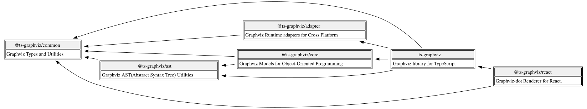
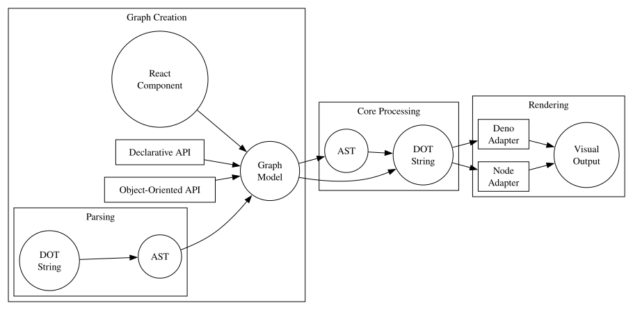

<div align="center">

[](https://github.com/ts-graphviz/ts-graphviz/actions/workflows/main.yaml)
[](https://github.com/ts-graphviz/ts-graphviz/actions/workflows/codeql-analysis.yml)
[](https://github.com/ts-graphviz/ts-graphviz/blob/main/LICENSE)
[](#contributors-)

[](https://www.bestpractices.dev/projects/8396)
[](https://scorecard.dev/viewer/?uri=github.com/ts-graphviz/ts-graphviz)
[](https://tidelift.com/subscription/pkg/npm-ts-graphviz?utm_source=npm-ts-graphviz&utm_medium=readme)

[](https://badge.fury.io/js/ts-graphviz)

[](https://github.com/denoland/deno)
[](https://npmtrends.com/ts-graphviz)

# ts-graphviz

[Graphviz](https://graphviz.gitlab.io/) library for TypeScript.

🔗

[](https://github.com/ts-graphviz/ts-graphviz)
[](https://www.npmjs.com/package/ts-graphviz)
[](https://ts-graphviz.github.io/api/)
[](https://deepwiki.com/ts-graphviz/ts-graphviz)

[](https://github.com/sponsors/ts-graphviz)
[](https://opencollective.com/ts-graphviz)

[](https://biomejs.dev/)
[](https://vitest.dev/)
[](https://vite.dev/)

<a href="https://flatt.tech/oss/gmo/trampoline" target="_blank"></a>

</div>

---

## What is ts-graphviz? 🎯

**ts-graphviz** is a TypeScript library for creating, reading, changing and rendering graphs in the DOT language of [Graphviz](https://graphviz.org/).
You write a graph with typed functions that read like DOT, and the library turns it into DOT text, and DOT text back into objects.

## Key Features ✨

- **DOT DSL**
  - `digraph()`, `g.node()`, `g.edge()` and `g.subgraph()` describe a graph statement by statement, and attributes are properties (`g.rankdir = 'LR'`).
- **Typed attributes**
  - Attribute names and values are checked by TypeScript for each kind of object (graph, node, edge, subgraph).
- **Models and AST**
  - The DSL is backed by model classes (`Digraph`, `Node`, `Edge`, …), the lower-level API, and by an AST with a DOT parser and printer.
- **DOT in both directions**
  - `toDot()` writes a graph as DOT and `fromDot()` parses DOT into a graph.
- **Modular**
  - Separate packages for the models, the AST, the Graphviz adapter and the React renderer.
- **Extensible**
  - Model classes can be subclassed and the attribute types can be extended.

## Why ts-graphviz? 🤔

Writing DOT as strings gives no help with attribute names, value types or escaping. **ts-graphviz** lets a TypeScript or JavaScript program build the graph as data: the compiler checks the attributes, IDs and labels are escaped when the DOT is written, and an existing DOT file can be parsed, changed and written again.
It fits programs that generate graphs from data, such as dependency graphs, schema diagrams and state machines.

## Requirements

- Node.js 22 or later, or the current Deno LTS
- TypeScript 5.0 or later (when you use TypeScript)
- ES modules only: the packages have no CommonJS build

The models, the DSL and the AST run in any JavaScript runtime, including browsers. Rendering images with `ts-graphviz/adapter` runs the Graphviz `dot` command, so it needs Node.js or Deno and an installed [Graphviz](https://graphviz.org/download/).

Upgrading from an earlier major version? See the [migration guide](https://ts-graphviz.github.io/docs/ts-graphviz/migration-guides/v3-to-v4/).

## Getting Started 🚀

### Installation 💽

```bash
# npm
$ npm install -S ts-graphviz
# or yarn
$ yarn add ts-graphviz
# or pnpm
$ pnpm add ts-graphviz
```

With Deno, import the package with the `npm:` specifier:

```ts no-check
import { digraph, toDot } from 'npm:ts-graphviz';
```

### Basic Usage 📖

```ts
import { digraph, toDot } from 'ts-graphviz';

const G = digraph('G', (g) => {
  g.rankdir = 'LR';

  const a = g.node('a', { color: 'red' });
  const b = g.node('b', { color: 'blue' });
  g.edge([a, b], { label: 'connects to' });

  g.subgraph('cluster_A', (s) => {
    s.label = 'Group';
    s.edge(['c', 'd']);
  });
});

console.log(toDot(G));
// digraph "G" {
//   rankdir = "LR";
//   "a" [
//     color = "red";
//   ];
//   "b" [
//     color = "blue";
//   ];
//   "a" -> "b" [
//     label = "connects to";
//   ];
//   subgraph "cluster_A" {
//     label = "Group";
//     "c" -> "d";
//   }
// }
```

To render the graph as an image, pass it to `toBlob()` of `ts-graphviz/adapter`.

Where to go next:

- [ts-graphviz package README](https://github.com/ts-graphviz/ts-graphviz/blob/main/packages/ts-graphviz/README.md): the usage guide (the DSL, model classes, `fromDot()`, the adapter, the AST, errors, extending the types)
- [DOT DSL guide](https://ts-graphviz.github.io/docs/ts-graphviz/guides/dot-dsl/) and [Model API guide](https://ts-graphviz.github.io/docs/ts-graphviz/guides/model-api/) on the website
- [@ts-graphviz/react README](https://github.com/ts-graphviz/ts-graphviz/blob/main/packages/react/README.md): writing graphs as React components
- [Migration guide](https://ts-graphviz.github.io/docs/ts-graphviz/migration-guides/v3-to-v4/)

## Useful Links 🔗

### Documentation 📖

- [Website](https://ts-graphviz.github.io/)
  - Guides and the migration guide.
- [API Reference](https://ts-graphviz.github.io/api/)
  - Reference of every exported function, class and type.
- [DeepWiki](https://deepwiki.com/ts-graphviz/ts-graphviz)
  - AI generated documentation, where you can also ask questions about the library.

### Architecture 🏛

See [ARCHITECTURE.md](https://github.com/ts-graphviz/ts-graphviz/blob/main/ARCHITECTURE.md) for more details.

### Security 🛡️

See [SECURITY.md](https://github.com/ts-graphviz/ts-graphviz/blob/main/SECURITY.md) for how to report a vulnerability, [Security Policies](https://ts-graphviz.github.io/docs/ts-graphviz/advanced-topics/security-policies/) for the measures in place, and the [security model](https://ts-graphviz.github.io/docs/ts-graphviz/advanced-topics/security-model/) for the trust boundaries and guarantees of the library: what you may pass it from untrusted sources (DOT text, strings in models) and what remains your responsibility (`htmlLike()` content, the adapter's command options, attributes Graphviz resolves as files).

## Package Structure 📦

The **ts-graphviz** repository is a monorepo. Most users need only `ts-graphviz`, which includes the other packages except the React renderer:

| Package | Purpose |
| --- | --- |
| [ts-graphviz](https://github.com/ts-graphviz/ts-graphviz/blob/main/packages/ts-graphviz/README.md) | Main entry point: the DOT DSL, the model classes, `toDot()` and `fromDot()`; `ts-graphviz/ast` and `ts-graphviz/adapter` entries |
| [@ts-graphviz/core](https://github.com/ts-graphviz/ts-graphviz/blob/main/packages/core/README.md) | The DSL factories and the model classes |
| [@ts-graphviz/ast](https://github.com/ts-graphviz/ts-graphviz/blob/main/packages/ast/README.md) | DOT parser, printer and AST; conversion between AST and models |
| [@ts-graphviz/adapter](https://github.com/ts-graphviz/ts-graphviz/blob/main/packages/adapter/README.md) | Runs the Graphviz `dot` command to render images (Node.js and Deno) |
| [@ts-graphviz/common](https://github.com/ts-graphviz/ts-graphviz/blob/main/packages/common/README.md) | Shared types (attributes, model interfaces) and utilities |
| [@ts-graphviz/react](https://github.com/ts-graphviz/ts-graphviz/blob/main/packages/react/README.md) | React components and a renderer that produce DOT |

> [!TIP]
> 
> _Packages' Dependency graph_

## Data Flow and Processing Pipeline 🔄



1. **Creation**: a graph model is created with the DOT DSL, the model classes or React components, or by parsing DOT text.
2. **Processing**: the model is converted to an AST and then to DOT text. `toDot()` is `fromModel()` followed by `stringify()`; `fromDot()` is `parse()` followed by `toModel()`.
3. **Rendering**: the adapter passes DOT text to the Graphviz `dot` command, which writes the image.

> [!TIP]
> The adapter does not render in the browser. Use a library such as [@hpcc-js/wasm-graphviz](https://www.npmjs.com/package/@hpcc-js/wasm-graphviz) to render DOT text there.

## Who's using `ts-graphviz` 📜

- [Apollo GraphQL](https://github.com/apollographql)
- [Apple](https://github.com/apple/ml-mycelium)
- [AWS](https://github.com/aws)
- [IBM (StrongLoop)](https://strongloop.com)
- [The University of Tokyo](https://github.com/csg-tokyo)
- [Transmute](https://github.com/transmute-industries)

> [!NOTE]
> Let us know that you're using `ts-graphviz` on [GitHub Discussions](https://github.com/ts-graphviz/ts-graphviz/discussions/736) 🙏


## Related Projects 💫

Related projects can be found at [**ts-graphviz** GitHub Organization](https://github.com/ts-graphviz).

The TypeScript/JavaScript ecosystem provides a variety of OSS with the goal of making Graphviz more connected and easier to use.

## Contributors 👥

Thanks goes to these wonderful people ([emoji key](https://allcontributors.org/docs/en/emoji-key)):

<!-- ALL-CONTRIBUTORS-LIST:START - Do not remove or modify this section -->
<!-- prettier-ignore-start -->
<!-- markdownlint-disable -->
<table>
  <tbody>
    <tr>
      <td align="center" valign="top" width="14.28%"><a href="http://blog.kamiazya.tech/"><br /><sub><b>Yuki Yamazaki</b></sub></a><br /><a href="https://github.com/ts-graphviz/ts-graphviz/commits?author=kamiazya" title="Code">💻</a> <a href="https://github.com/ts-graphviz/ts-graphviz/commits?author=kamiazya" title="Tests">⚠️</a> <a href="https://github.com/ts-graphviz/ts-graphviz/commits?author=kamiazya" title="Documentation">📖</a> <a href="#ideas-kamiazya" title="Ideas, Planning, & Feedback">🤔</a></td>
      <td align="center" valign="top" width="14.28%"><a href="https://laysent.com"><br /><sub><b>LaySent</b></sub></a><br /><a href="https://github.com/ts-graphviz/ts-graphviz/issues?q=author%3Alaysent" title="Bug reports">🐛</a> <a href="https://github.com/ts-graphviz/ts-graphviz/commits?author=laysent" title="Tests">⚠️</a></td>
      <td align="center" valign="top" width="14.28%"><a href="https://github.com/elasticdotventures"><br /><sub><b>elasticdotventures</b></sub></a><br /><a href="https://github.com/ts-graphviz/ts-graphviz/commits?author=elasticdotventures" title="Documentation">📖</a></td>
      <td align="center" valign="top" width="14.28%"><a href="https://github.com/ChristianMurphy"><br /><sub><b>Christian Murphy</b></sub></a><br /><a href="https://github.com/ts-graphviz/ts-graphviz/commits?author=ChristianMurphy" title="Code">💻</a> <a href="#ideas-ChristianMurphy" title="Ideas, Planning, & Feedback">🤔</a> <a href="https://github.com/ts-graphviz/ts-graphviz/commits?author=ChristianMurphy" title="Documentation">📖</a></td>
      <td align="center" valign="top" width="14.28%"><a href="https://github.com/ArtemAdamenko"><br /><sub><b>Artem</b></sub></a><br /><a href="https://github.com/ts-graphviz/ts-graphviz/issues?q=author%3AArtemAdamenko" title="Bug reports">🐛</a></td>
      <td align="center" valign="top" width="14.28%"><a href="https://github.com/fredericohpandolfo"><br /><sub><b>fredericohpandolfo</b></sub></a><br /><a href="https://github.com/ts-graphviz/ts-graphviz/issues?q=author%3Afredericohpandolfo" title="Bug reports">🐛</a></td>
      <td align="center" valign="top" width="14.28%"><a href="https://github.com/diegoquinteiro"><br /><sub><b>diegoquinteiro</b></sub></a><br /><a href="https://github.com/ts-graphviz/ts-graphviz/issues?q=author%3Adiegoquinteiro" title="Bug reports">🐛</a></td>
    </tr>
    <tr>
      <td align="center" valign="top" width="14.28%"><a href="https://github.com/robross0606"><br /><sub><b>robross0606</b></sub></a><br /><a href="#ideas-robross0606" title="Ideas, Planning, & Feedback">🤔</a></td>
      <td align="center" valign="top" width="14.28%"><a href="https://blake-regalia.net"><br /><sub><b>Blake Regalia</b></sub></a><br /><a href="https://github.com/ts-graphviz/ts-graphviz/issues?q=author%3Ablake-regalia" title="Bug reports">🐛</a></td>
      <td align="center" valign="top" width="14.28%"><a href="https://github.com/bigbug"><br /><sub><b>bigbug</b></sub></a><br /><a href="#question-bigbug" title="Answering Questions">💬</a></td>
      <td align="center" valign="top" width="14.28%"><a href="https://github.com/murawakimitsuhiro"><br /><sub><b>mrwk</b></sub></a><br /><a href="#question-murawakimitsuhiro" title="Answering Questions">💬</a></td>
      <td align="center" valign="top" width="14.28%"><a href="https://github.com/svdvonde"><br /><sub><b>svdvonde</b></sub></a><br /><a href="#question-svdvonde" title="Answering Questions">💬</a></td>
      <td align="center" valign="top" width="14.28%"><a href="https://github.com/seethroughdev"><br /><sub><b>Adam</b></sub></a><br /><a href="#question-seethroughdev" title="Answering Questions">💬</a></td>
      <td align="center" valign="top" width="14.28%"><a href="https://github.com/trevor-scheer"><br /><sub><b>Trevor Scheer</b></sub></a><br /><a href="#a11y-trevor-scheer" title="Accessibility">️️️️♿️</a></td>
    </tr>
    <tr>
      <td align="center" valign="top" width="14.28%"><a href="https://pre.ms"><br /><sub><b>Prem Pillai</b></sub></a><br /><a href="https://github.com/ts-graphviz/ts-graphviz/issues?q=author%3Acloud-on-prem" title="Bug reports">🐛</a></td>
      <td align="center" valign="top" width="14.28%"><a href="https://github.com/nagasawaryoya"><br /><sub><b>nagasawaryoya</b></sub></a><br /><a href="https://github.com/ts-graphviz/ts-graphviz/commits?author=nagasawaryoya" title="Code">💻</a> <a href="https://github.com/ts-graphviz/ts-graphviz/commits?author=nagasawaryoya" title="Tests">⚠️</a></td>
      <td align="center" valign="top" width="14.28%"><a href="https://github.com/tokidrill"><br /><sub><b>YukiSasaki</b></sub></a><br /><a href="https://github.com/ts-graphviz/ts-graphviz/commits?author=tokidrill" title="Code">💻</a> <a href="https://github.com/ts-graphviz/ts-graphviz/commits?author=tokidrill" title="Tests">⚠️</a></td>
      <td align="center" valign="top" width="14.28%"><a href="https://github.com/Madd0g"><br /><sub><b>Madd0g</b></sub></a><br /><a href="https://github.com/ts-graphviz/ts-graphviz/issues?q=author%3AMadd0g" title="Bug reports">🐛</a></td>
      <td align="center" valign="top" width="14.28%"><a href="https://github.com/j4k0xb"><br /><sub><b>j4k0xb</b></sub></a><br /><a href="https://github.com/ts-graphviz/ts-graphviz/issues?q=author%3Aj4k0xb" title="Bug reports">🐛</a></td>
      <td align="center" valign="top" width="14.28%"><a href="https://github.com/haved"><br /><sub><b>HKrogstie</b></sub></a><br /><a href="https://github.com/ts-graphviz/ts-graphviz/issues?q=author%3Ahaved" title="Bug reports">🐛</a></td>
      <td align="center" valign="top" width="14.28%"><a href="https://github.com/septatrix"><br /><sub><b>Nils K</b></sub></a><br /><a href="https://github.com/ts-graphviz/ts-graphviz/issues?q=author%3Aseptatrix" title="Bug reports">🐛</a></td>
    </tr>
    <tr>
      <td align="center" valign="top" width="14.28%"><a href="https://github.com/hao2013"><br /><sub><b>hao2013</b></sub></a><br /><a href="#maintenance-hao2013" title="Maintenance">🚧</a> <a href="https://github.com/ts-graphviz/ts-graphviz/pulls?q=is%3Apr+reviewed-by%3Ahao2013" title="Reviewed Pull Requests">👀</a></td>
      <td align="center" valign="top" width="14.28%"><a href="http://www.walterra.dev"><br /><sub><b>Walter Rafelsberger</b></sub></a><br /><a href="#question-walterra" title="Answering Questions">💬</a></td>
      <td align="center" valign="top" width="14.28%"><a href="https://github.com/grsjst"><br /><sub><b>grsjst</b></sub></a><br /><a href="https://github.com/ts-graphviz/ts-graphviz/issues?q=author%3Agrsjst" title="Bug reports">🐛</a></td>
      <td align="center" valign="top" width="14.28%"><a href="https://github.com/stephenirven"><br /><sub><b>Steve</b></sub></a><br /><a href="https://github.com/ts-graphviz/ts-graphviz/issues?q=author%3Astephenirven" title="Bug reports">🐛</a></td>
      <td align="center" valign="top" width="14.28%"><a href="https://github.com/btomaj"><br /><sub><b>poetry by</b></sub></a><br /><a href="https://github.com/ts-graphviz/ts-graphviz/issues?q=author%3Abtomaj" title="Bug reports">🐛</a></td>
    </tr>
  </tbody>
</table>

<!-- markdownlint-restore -->
<!-- prettier-ignore-end -->

<!-- ALL-CONTRIBUTORS-LIST:END -->

This project follows the [all-contributors](https://github.com/all-contributors/all-contributors)
specification. Contributions of any kind welcome!

## How to Contribute 💪

The easiest way to contribute is to use the library and star [repository](https://github.com/ts-graphviz/ts-graphviz).

### Questions 💭

Feel free to ask questions on [GitHub Discussions](https://github.com/ts-graphviz/ts-graphviz/discussions).

### Report bugs / request additional features 💡

Please register at [GitHub Issues](https://github.com/ts-graphviz/ts-graphviz/issues/new/choose).

### Development / Bug Fixes 🧑‍💻

See [CONTRIBUTING.md](https://github.com/ts-graphviz/ts-graphviz/blob/main/CONTRIBUTING.md).

### Financial Support 💸

Support this project by becoming a sponsor. Your logo will show up here with a link to your website. [Become a sponsor](https://opencollective.com/ts-graphviz)


Thank you to all our backers! 🙏 [Become a backer](https://opencollective.com/ts-graphviz)


Please support ts-graphviz on [Open Collective](https://opencollective.com/ts-graphviz) or [GitHub Sponsors](https://github.com/sponsors/ts-graphviz).

> **Note** Even just a dollar is enough motivation to develop 😊

## ts-graphviz for Enterprise 🏢

Available as part of the Tidelift Subscription.

The maintainers of ts-graphviz and thousands of other packages are working with Tidelift to deliver commercial support and maintenance for the open-source dependencies you use to build your applications.
Save time, reduce risk, and improve code health, while paying the maintainers of the exact dependencies you use.

[Learn more](https://tidelift.com/subscription/pkg/npm-ts-graphviz?utm_source=npm-ts-graphviz&utm_medium=referral&utm_campaign=enterprise&utm_term=repo).

## Changelog 📜

See [CHANGELOG.md](https://github.com/ts-graphviz/ts-graphviz/blob/main/packages/ts-graphviz/CHANGELOG.md) for more details.

## License ⚖️

This software is released under the MIT License, see [LICENSE](https://github.com/ts-graphviz/ts-graphviz/blob/main/LICENSE).
