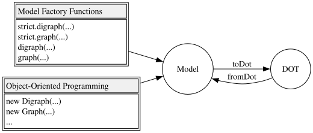
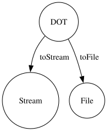
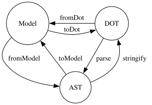

<div align="center">

[](https://github.com/ts-graphviz/ts-graphviz/actions/workflows/main.yaml)
[](https://github.com/ts-graphviz/ts-graphviz/actions/workflows/codeql-analysis.yml)
[](https://github.com/ts-graphviz/ts-graphviz/blob/main/LICENSE)
[](#contributors-)

[](https://www.bestpractices.dev/projects/8396)
[](https://scorecard.dev/viewer/?uri=github.com/ts-graphviz/ts-graphviz)
[](https://tidelift.com/subscription/pkg/npm-ts-graphviz?utm_source=npm-ts-graphviz&utm_medium=readme)

[](https://badge.fury.io/js/ts-graphviz)

[](https://github.com/denoland/deno)
[](https://npmtrends.com/ts-graphviz)

# ts-graphviz

[Graphviz](https://graphviz.gitlab.io/) library for TypeScript.

🔗

[](https://github.com/ts-graphviz/ts-graphviz)
[](https://www.npmjs.com/package/ts-graphviz)
[](https://ts-graphviz.github.io/api/)
[](https://deepwiki.com/ts-graphviz/ts-graphviz)

[](https://github.com/sponsors/ts-graphviz)
[](https://opencollective.com/ts-graphviz)

[](https://biomejs.dev/)
[](https://vitest.dev/)
[](https://vite.dev/)

</div>

---

## Key Features ✨

`ts-graphviz` builds, reads and changes graphs in the Graphviz DOT language from TypeScript.

- **DOT DSL**
  - The factories `digraph()`, `graph()`, `strict.digraph()` and `strict.graph()` give a DSL that reads like DOT: the DOT statements are its methods, and attributes are its properties.
- **Models**
  - Under the DSL are the model classes `Digraph`, `Graph`, `Subgraph`, `Node` and `Edge`, the lower-level API. `modelOf()` gives the model of a DSL object, and `dsl()` the DSL of a model.
- **TypeScript-friendly API**
  - Attributes and their values are typed, so your editor completes them and the compiler checks them.
- **DOT in both directions**
  - `toDot` writes a graph as DOT, and `fromDot` reads DOT into a graph. The `ts-graphviz/ast` entry gives the syntax tree in between.
- **Modular and Extensible**
  - The library is split into packages, each with one purpose. You can replace the model classes with your own and add attributes to the types.
- **Cross Platform**
  - The DSL, the models and the AST run in any JavaScript runtime, browsers included. Rendering through the Graphviz `dot` command (`ts-graphviz/adapter`) needs Node.js or Deno.

## Requirements

- Node.js 22 or later, or the current Deno LTS.
- TypeScript 5.0 or later, for TypeScript users.
- The packages are ES modules only.

Upgrading from an earlier major version? See the [migration guide](https://ts-graphviz.github.io/docs/ts-graphviz/migration-guides/v3-to-v4/).

## Installation 💽

### Node.js

This package can then be installed using a package manager.

```bash
# npm
$ npm install -S ts-graphviz
# or yarn
$ yarn add ts-graphviz
# or pnpm
$ pnpm add ts-graphviz
```

> **Note** Want to try before installing? Check out [Runkit](https://npm.runkit.com/ts-graphviz) to see how it works.

### Deno 🦕

The current Deno LTS is supported. Import the package with an `npm:` specifier:

```ts no-check
import { toDot } from 'npm:ts-graphviz';
```

## Usage 📑

This section provides an overview of the package.

The [guides on the website](https://ts-graphviz.github.io/docs/ts-graphviz/guides/dot-dsl/) go further, and the [API reference](https://ts-graphviz.github.io/api/) is generated from the comments in the TypeScript type definitions.

### `ts-graphviz` Module 🚩

This module provides the **DOT DSL** and the **Model**, the interfaces for working with the DOT language in JavaScript/TypeScript.



#### DOT DSL 😎

The factories `digraph()`, `graph()`, `strict.digraph()` and `strict.graph()` give the graph's **DOT DSL**: the DOT statements `node`, `edge`, `subgraph` and `graph` are methods, and attributes are properties under their own names. The `toDot` function converts the graph to **DOT** (a DOT language string).

```ts
import { digraph, toDot } from 'ts-graphviz';

const G = digraph('G', (g) => {
  g.rankdir = 'LR'; //  rankdir = "LR";
  g.node({ shape: 'box' }); //  node [shape = "box";];
  const a = g.node('a');
  a.label = 'A'; //  "a" [label = "A";];
  g.edge([a, 'b']); //  "a" -> "b";
});

console.log(toDot(G));
// digraph "G" {
//   rankdir = "LR";
//   node [
//     shape = "box";
//   ];
//   "a" [
//     label = "A";
//   ];
//   "a" -> "b";
// }
```

Statements are written in the order they are added. Subgraphs nest, and `port()` gives a node at a port for an edge target:

```ts
import { digraph, toDot } from 'ts-graphviz';

const G = digraph('G', (g) => {
  const a = g.node('aa');
  const b = g.node('bb');
  const c = g.node('cc');
  g.edge([a, b, c], { color: 'red' });
  g.subgraph('A', (A) => {
    const Aa = A.node('Aaa', { color: 'pink' });
    const Ab = A.node('Abb', { color: 'violet' });
    const Ac = A.node('Acc');
    A.edge([Aa.port('a'), Ab, Ac, 'E'], { color: 'red' });
  });
});

console.log(toDot(G));
// digraph "G" {
//   "aa";
//   "bb";
//   "cc";
//   "aa" -> "bb" -> "cc" [
//     color = "red";
//   ];
//   subgraph "A" {
//     "Aaa" [
//       color = "pink";
//     ];
//     "Abb" [
//       color = "violet";
//     ];
//     "Acc";
//     "Aaa":"a" -> "Abb" -> "Acc" -> "E" [
//       color = "red";
//     ];
//   }
// }
```

`strict.digraph()` and `strict.graph()` create strict graphs:

```ts
import { strict, toDot } from 'ts-graphviz';

const G = strict.graph((g) => {
  g.edge(['a', 'b']);
});

console.log(toDot(G));
// strict graph {
//   "a" -- "b";
// }
```

##### The DSL and the model

Besides the statements and the attributes, the DSL has only `addComment`, a node's `port`, `$$type` and an attribute list's `$$kind` (`a.id` is the node's `id` attribute). The model's other members are on `modelOf(x)` (`modelOf(a).id` is the node's name). The statements return DSLs; `modelOf()` gives the model, and `toDot` takes either. `addComment` returns the `CommentModel` itself (not a DSL), which `modelOf(a).removeComment(comment)` removes.

```ts
import { digraph, modelOf } from 'ts-graphviz';

digraph('G', (g) => {
  const a = g.node('a');
  a.id = 'svg-a'; // the Graphviz id attribute
  console.log(a.id);
  // svg-a
  console.log(modelOf(a).id); // the node's name
  // a
  console.log(modelOf(g).nodes.length);
  // 1
});
```

See [Writing Graphs with the DOT DSL](https://ts-graphviz.github.io/docs/ts-graphviz/guides/dot-dsl/) for the whole DSL.

##### `fromDot` function ⏪

The main scenario for using this library is to use the `toDot` function, but it also supports conversions in the reverse direction.

By converting **DOT** to a graph, a portion of the code can be written in the DOT language.

```ts
import { fromDot, toDot } from 'ts-graphviz';

// fromDot gives the model; with { dsl: true }, its DOT DSL.
const G = fromDot(
  `digraph {
    node_A [
      label = "This is a Label of Node A";
    ];
  }`,
  { dsl: true },
);

G.edge(['node_A', 'node_B']);

console.log(toDot(G));
// digraph {
//   "node_A" [
//     label = "This is a Label of Node A";
//   ];
//   "node_A" -> "node_B";
// }
```

<details>
<summary>Advanced Usage</summary>

##### Model Kit ( `withModelKit` function ) 💈

The `withModelKit` function takes model classes of your own and returns factories (`digraph`, `graph`, `strict`) that create graphs with them. A class left out keeps the default.

The statements of such a graph create your classes, in nested subgraphs too, and `modelOf()` gives them with their types.

```ts
import {
  attribute as _,
  Digraph,
  Edge,
  type EdgeTargetTuple,
  modelOf,
  Node,
  toDot,
  withModelKit,
} from 'ts-graphviz';

class MyCustomDigraph extends Digraph {
  constructor() {
    super('G', {
      [_.label]: 'This is Custom Digraph',
    });
  }
}

class MyCustomNode extends Node {
  constructor(id: string) {
    super(`node_${id}`, {
      [_.label]: `This is Custom Node ${id}`,
    });
  }
}

class MyCustomEdge extends Edge {
  constructor(targets: EdgeTargetTuple) {
    super(targets, {
      [_.label]: 'This is Custom Edge',
    });
  }
}

const { digraph } = withModelKit({
  Digraph: MyCustomDigraph,
  Node: MyCustomNode,
  Edge: MyCustomEdge,
});

const G = digraph((g) => {
  const a = g.node('A'); // the DSL of a MyCustomNode
  const b = g.node('B');
  g.edge([a, b]); // the DSL of a MyCustomEdge
  console.log(modelOf(a) instanceof MyCustomNode);
  // true
});

console.log(toDot(G));
// digraph "G" {
//   label = "This is Custom Digraph";
//   "node_A" [
//     label = "This is Custom Node A";
//   ];
//   "node_B" [
//     label = "This is Custom Node B";
//   ];
//   "node_A" -> "node_B" [
//     label = "This is Custom Edge";
//   ];
// }
```

</details>

#### Model Classes ❤️

The **Model** is the lower-level API under the DSL. It provides the classes `Digraph`, `Graph`, `Subgraph`, `Node`, and `Edge`, which you create and put together yourself.

```ts
import { attribute as _, Digraph, Edge, Node, Subgraph, toDot } from 'ts-graphviz';

const G = new Digraph();
const A = new Subgraph('A');
const node1 = new Node('node1', {
  [_.color]: 'red',
});
const node2 = new Node('node2', {
  [_.color]: 'blue',
});
const edge = new Edge([node1, node2], {
  [_.label]: 'Edge Label',
  [_.color]: 'pink',
});
G.addSubgraph(A);
A.addNode(node1);
A.addNode(node2);
A.addEdge(edge);

console.log(toDot(G));
// digraph {
//   subgraph "A" {
//     "node1" [
//       color = "red";
//     ];
//     "node2" [
//       color = "blue";
//     ];
//     "node1" -> "node2" [
//       label = "Edge Label";
//       color = "pink";
//     ];
//   }
// }
```

The model classes have `createNode`, `createEdge` and `createSubgraph`, and the `add…`, `get…` and `remove…` methods; the statement methods `node()`, `edge()` and `subgraph()` are on the DSL only. `dsl(model)` gives the DSL of a model:

```ts
import { Digraph, dsl, toDot } from 'ts-graphviz';

const G = new Digraph('G');
G.createNode('a');

const g = dsl(G);
g.edge(['a', 'b'], { color: 'red' });

console.log(toDot(G));
// digraph "G" {
//   "a";
//   "a" -> "b" [
//     color = "red";
//   ];
// }
```

See [DOT Object Model (DOM)](https://ts-graphviz.github.io/docs/ts-graphviz/guides/model-api/) for more.

<details>
<summary>Advanced Usage</summary>

##### Custom Class 🤖

You can also add your own implementation by inheriting from the class.

```ts
import {
  attribute as _,
  Digraph,
  Edge,
  type EdgeTargetTuple,
  Node,
  toDot,
} from 'ts-graphviz';

class MyCustomDigraph extends Digraph {
  constructor() {
    super('G', {
      [_.label]: 'This is Custom Digraph',
    });
  }
}
class MyCustomNode extends Node {
  constructor(id: string) {
    super(`node_${id}`, {
      [_.label]: `This is Custom Node ${id}`,
    });
  }
}

class MyCustomEdge extends Edge {
  constructor(targets: EdgeTargetTuple) {
    super(targets, {
      [_.label]: 'This is Custom Edge',
    });
  }
}

const digraph = new MyCustomDigraph();
const node1 = new MyCustomNode('A');
const node2 = new MyCustomNode('B');
const edge = new MyCustomEdge([node1, node2]);
digraph.addNode(node1);
digraph.addNode(node2);
digraph.addEdge(edge);

console.log(toDot(digraph));
// digraph "G" {
//   label = "This is Custom Digraph";
//   "node_A" [
//     label = "This is Custom Node A";
//   ];
//   "node_B" [
//     label = "This is Custom Node B";
//   ];
//   "node_A" -> "node_B" [
//     label = "This is Custom Edge";
//   ];
// }
```

##### Model classes of a graph ( `with` method) 🧅

You can also give a graph the classes to create custom classes for objects generated inside of Graph.

The `with` methods of `Digraph`, `Graph`, and `Subgraph`, which are implementations of `GraphBaseModel`, are provided to predefine custom models.

```ts
import {
  attribute as _,
  Digraph,
  Edge,
  type EdgeTargetTuple,
  Node,
  toDot,
} from 'ts-graphviz';

class MyCustomNode extends Node {
  constructor(id: string) {
    super(`node_${id}`, {
      [_.label]: `This is Custom Node ${id}`,
    });
  }
}

class MyCustomEdge extends Edge {
  constructor(targets: EdgeTargetTuple) {
    super(targets, {
      [_.label]: 'This is Custom Edge',
    });
  }
}

const g = new Digraph();
g.with({
  Node: MyCustomNode,
  Edge: MyCustomEdge,
});
const a = g.createNode('A'); // MyCustomNode
const b = g.createNode('B'); // MyCustomNode
g.createEdge([a, b]); // MyCustomEdge

console.log(toDot(g));
// digraph {
//   "node_A" [
//     label = "This is Custom Node A";
//   ];
//   "node_B" [
//     label = "This is Custom Node B";
//   ];
//   "node_A" -> "node_B" [
//     label = "This is Custom Edge";
//   ];
// }
```

</details>

### Attribute Values: Literal Text, escStrings and HTML-Like Labels 🔤

A plain `string` in a model is **literal text**. `toDot` escapes it completely, so any text — quotes, backslashes, newlines, user input — is written safely into the DOT output, and `fromDot` gives the same text back. For values that carry DOT syntax of their own, say so explicitly:

```ts
import { digraph, escString, htmlLike, toDot } from 'ts-graphviz';

const G = digraph('G', (g) => {
  // literal text: a JS newline becomes a line break, `"` and `\` are escaped
  g.node('a', { label: 'line 1\nline 2 with "quotes"' });
  // Graphviz escString: \N, \G, \l, ... keep their meaning (only `"` is escaped)
  g.node('b', { label: escString('\\N\\lleft-justified') });
  // HTML-like label: the markup between the outer < and >
  g.node('c', { label: htmlLike('<b>bold</b>') });
});

console.log(toDot(G));
// digraph "G" {
//   "a" [
//     label = "line 1\nline 2 with \"quotes\"";
//   ];
//   "b" [
//     label = "\N\lleft-justified";
//   ];
//   "c" [
//     label = <<b>bold</b>>;
//   ];
// }
```

`fromDot` maps the other way: `\\` and `\"` in a quoted string become literal characters, `\n` and `\r` become a line feed and a carriage return, any other backslash sequence yields an `escString`, and `<…>` yields an `htmlLike` value. The `isEscString` and `isHTMLLike` guards tell the kinds apart.

### `ts-graphviz/adapter` Module 🔌

Provides an interface to run Graphviz dot commands.

[Graphviz](https://graphviz.gitlab.io/) must be installed so that the dot command can be executed.

Execute the dot command and get its output as a `Blob`.



The `toBlob` function renders **DOT** (or a graph) to a **Blob**, whose `type` is the media type of the format.

```ts
import { writeFile } from 'node:fs/promises';
import { digraph } from 'ts-graphviz';
import { toBlob } from 'ts-graphviz/adapter';

const G = digraph('example', (g) => {
  g.node('node1', { label: 'My Node' });
});

const blob = await toBlob(G, { format: 'svg' }); // blob.type is 'image/svg+xml'
const svg = await blob.text();
// Writing it to a file is up to you:
await writeFile('./result.svg', blob.stream());
```

> **Note** The adapter runs on Node.js and Deno; in a browser, `toBlob` throws an error with the code `TSG_ERR_UNSUPPORTED_ENVIRONMENT`. The output is held in memory, and a failure of the command rejects the promise before you read anything. Call `toBlob` with `await` inside `try`: the browser entry and the conversion of a model to DOT throw before a promise is returned.
>
> By default, `toBlob` runs `sanitize` on the DOT before it renders: a DOT with an attribute that makes Graphviz read a file (such as `image`) or an unsafe link, and an output format that has not been checked, are rejected with the code `TSG_ERR_UNSAFE_DOT`; nothing is removed for you. See the [`@ts-graphviz/adapter` README](https://github.com/ts-graphviz/ts-graphviz/blob/main/packages/adapter/README.md) for the options and the security notes.

### `ts-graphviz/ast` Module 🔢

An API is provided to handle ASTs for advanced use.



The following functions are provided as described in the state transition diagram.

- The `fromModel` function converts **Model** to **AST**.
- The `toModel` function converts **AST** to **Model**. It takes the model classes to create as `{ models }`; `defaultModelKit` gives the default ones.
- The `stringify` function converts **AST** to **DOT**.
- The `parse` function converts **DOT** to **AST**.
- The `sanitize` function takes **DOT** and returns **DOT** that is safe to render from an untrusted source, or throws.

> **Note** As you can see from the above figure, the `toDot` function provided by the `ts-graphviz` package is a composite of `fromModel` and `stringify`. The `fromDot` function is a composite of `parse` and `toModel`.

```ts
import { defaultModelKit, toDot } from 'ts-graphviz';
import { fromModel, parse, stringify, toModel } from 'ts-graphviz/ast';

const ast = parse('digraph example { a -> b; }');

// AST -> Model -> AST -> DOT
const model = toModel(ast, { models: defaultModelKit });
console.log(stringify(fromModel(model)) === toDot(model));
// true

console.log(stringify(ast));
// digraph example {
//   a -> b;
// }
```

See the [`@ts-graphviz/ast` README](https://github.com/ts-graphviz/ts-graphviz/blob/main/packages/ast/README.md) for the parser options and limits.

<details>
<summary>The parse function and AST</summary>

```ts
import { parse } from 'ts-graphviz/ast';

const ast = parse(`
  digraph example {
    node1 [
      label = "My Node",
    ]
  }
`);

console.dir(ast, { depth: null });
// {
//   location: {
//     source: undefined,
//     start: { offset: 3, line: 2, column: 3 },
//     end: { offset: 68, line: 7, column: 1 }
//   },
//   type: 'Dot',
//   children: [
//     {
//       location: {
//         source: undefined,
//         start: { offset: 3, line: 2, column: 3 },
//         end: { offset: 67, line: 6, column: 4 }
//       },
//       id: {
//         location: {
//           source: undefined,
//           start: { offset: 11, line: 2, column: 11 },
//           end: { offset: 18, line: 2, column: 18 }
//         },
//         value: 'example',
//         kind: 'bare',
//         type: 'Literal'
//       },
//       directed: true,
//       strict: false,
//       type: 'Graph',
//       children: [
//         {
//           location: {
//             source: undefined,
//             start: { offset: 25, line: 3, column: 5 },
//             end: { offset: 63, line: 5, column: 6 }
//           },
//           id: {
//             location: {
//               source: undefined,
//               start: { offset: 25, line: 3, column: 5 },
//               end: { offset: 30, line: 3, column: 10 }
//             },
//             value: 'node1',
//             kind: 'bare',
//             type: 'Literal'
//           },
//           type: 'Node',
//           children: [
//             {
//               location: {
//                 source: undefined,
//                 start: { offset: 39, line: 4, column: 7 },
//                 end: { offset: 57, line: 4, column: 25 }
//               },
//               key: {
//                 location: {
//                   source: undefined,
//                   start: { offset: 39, line: 4, column: 7 },
//                   end: { offset: 44, line: 4, column: 12 }
//                 },
//                 value: 'label',
//                 kind: 'bare',
//                 type: 'Literal'
//               },
//               value: {
//                 location: {
//                   source: undefined,
//                   start: { offset: 47, line: 4, column: 15 },
//                   end: { offset: 56, line: 4, column: 24 }
//                 },
//                 value: 'My Node',
//                 kind: 'quoted',
//                 type: 'Literal'
//               },
//               type: 'Attribute'
//             }
//           ]
//         }
//       ]
//     }
//   ]
// }
```

</details>

### Errors

An error the library raises for a documented failure is a standard error type (`SyntaxError`, `RangeError`, `TypeError`, …) with a `code` that starts with `TSG_ERR_`. `isTsGraphvizError` tells such an error from any other. Match on the `code`, not on the message.

```ts
import { fromDot, isTsGraphvizError } from 'ts-graphviz';

try {
  fromDot('digraph { a -> }');
} catch (e) {
  if (isTsGraphvizError(e)) {
    console.log(e.name, e.code);
  }
}
// DotSyntaxError TSG_ERR_DOT_SYNTAX
```

The codes are listed in the [migration guide](https://ts-graphviz.github.io/docs/ts-graphviz/migration-guides/v3-to-v4/#3-errors-standard-types-with-a-stable-code).

### `ts-graphviz/legacy` Module

A default attribute statement (`g.node({ ... })`, `g.edge({ ... })`, `g.graph({ ... })`) is written where it was added and applies to what follows it, as in DOT. The `ts-graphviz/legacy` entry has the same API with classes that write every default first. It is deprecated and will be removed in v5; see the [migration guide](https://ts-graphviz.github.io/docs/ts-graphviz/migration-guides/v3-to-v4/#13-default-attribute-statements-keep-their-place).

### Extending the Type System 🧰

With ts-graphviz, you can extend the library's type system to customize graph visualization solutions to meet specific needs.

#### Use Case: Adding Custom Attributes

> **Note** To allow for customization, types are named with the `$` symbol.
>
> If you want to extend a type definition in cases not listed below, check the source code to see if you can extend it with `$...`.
>
> If not, please create an issue or pull request.

```ts
import { $keywords } from '@ts-graphviz/common';
import { digraph, toDot, attribute as _ } from 'ts-graphviz';

// 1. Declare the '@ts-graphviz/common' module.
declare module '@ts-graphviz/common' {
  export namespace GraphAttributeKey {
    // 2. Define the $values interface in the GraphAttributeKey namespace.
    // 3. Inherit from $keywords<'hoge'> and specify the name of the new attribute in <...>.
    export interface $values extends $keywords<'hoge'> {}
  }

  export namespace Attribute {
    // 4. Define the $keys interface in the Attribute namespace.
    // 5. Inherit from $keywords<'hoge'> and specify the name of the new attribute in <...>.
    export interface $keys extends $keywords<'hoge'> {}

    // 6. Define the $types interface in the Attribute namespace.
    // 7. Specify the new attribute in the key and define its corresponding value in the value.
    export interface $types {
      hoge: string;
    }
  }
}

console.log(
  toDot(
    digraph((g) => {
      g[_.hoge] = 'fuga';
    }),
  ),
);
// digraph {
//   hoge = "fuga";
// }
```

This changes the types everywhere in your program. To type the attributes of one set of models only, the model types and classes take a `Schema` type parameter instead (`class MyNode extends Node<MySchema> {}`).

#### Use Case: Specifying Custom Graph Layout and Output Formats

Layout engines and output formats that a Graphviz plugin adds need no type extension. Name them for one call with the `customLayouts` and `customFormats` options of `toBlob`; they widen the types of `layout` and `format` for that call only.

```ts
import { toBlob } from 'ts-graphviz/adapter';

// 'my-custom-algorithm' and 'mp4' stand for the names your plugin adds.
const video = await toBlob('digraph { a -> b }', {
  customLayouts: ['my-custom-algorithm'],
  customFormats: ['mp4'],
  layout: 'my-custom-algorithm',
  format: 'mp4',
  // sanitize refuses formats it has not checked
  sanitize: false,
});
```

These names are trusted configuration: define them in your code, never from end-user input.

## Deep dive 🏊‍♂️

### Architecture 🏛

See [ARCHITECTURE.md](https://github.com/ts-graphviz/ts-graphviz/blob/main/ARCHITECTURE.md) for more details.

### Security 🛡️

See [SECURITY.md](https://github.com/ts-graphviz/ts-graphviz/blob/main/SECURITY.md) for how to report a vulnerability, [Security Policies](https://ts-graphviz.github.io/docs/ts-graphviz/advanced-topics/security-policies/) for the measures in place, and the [security model](https://ts-graphviz.github.io/docs/ts-graphviz/advanced-topics/security-model/) for the guarantees of the library.


## Who's using `ts-graphviz` 📜

- [Apollo GraphQL](https://github.com/apollographql)
- [Apple](https://github.com/apple/ml-mycelium)
- [AWS](https://github.com/aws)
- [IBM (StrongLoop)](https://strongloop.com)
- [The University of Tokyo](https://github.com/csg-tokyo)
- [Transmute](https://github.com/transmute-industries)

> **Note** Let us know that you're using `ts-graphviz` on [GitHub Discussions](https://github.com/ts-graphviz/ts-graphviz/discussions/736) 🙏


## Related Projects 💫

Related projects can be found at [**ts-graphviz** GitHub Organization](https://github.com/ts-graphviz).

The TypeScript/JavaScript ecosystem provides a variety of OSS with the goal of making Graphviz more connected and easier to use.

## Contributors 👥

Thanks goes to these wonderful people ([emoji key](https://allcontributors.org/docs/en/emoji-key)):

<!-- ALL-CONTRIBUTORS-LIST:START - Do not remove or modify this section -->
<!-- prettier-ignore-start -->
<!-- markdownlint-disable -->
<table>
  <tbody>
    <tr>
      <td align="center" valign="top" width="14.28%"><a href="http://blog.kamiazya.tech/"><br /><sub><b>Yuki Yamazaki</b></sub></a><br /><a href="https://github.com/ts-graphviz/ts-graphviz/commits?author=kamiazya" title="Code">💻</a> <a href="https://github.com/ts-graphviz/ts-graphviz/commits?author=kamiazya" title="Tests">⚠️</a> <a href="https://github.com/ts-graphviz/ts-graphviz/commits?author=kamiazya" title="Documentation">📖</a> <a href="#ideas-kamiazya" title="Ideas, Planning, & Feedback">🤔</a></td>
      <td align="center" valign="top" width="14.28%"><a href="https://laysent.com"><br /><sub><b>LaySent</b></sub></a><br /><a href="https://github.com/ts-graphviz/ts-graphviz/issues?q=author%3Alaysent" title="Bug reports">🐛</a> <a href="https://github.com/ts-graphviz/ts-graphviz/commits?author=laysent" title="Tests">⚠️</a></td>
      <td align="center" valign="top" width="14.28%"><a href="https://github.com/elasticdotventures"><br /><sub><b>elasticdotventures</b></sub></a><br /><a href="https://github.com/ts-graphviz/ts-graphviz/commits?author=elasticdotventures" title="Documentation">📖</a></td>
      <td align="center" valign="top" width="14.28%"><a href="https://github.com/ChristianMurphy"><br /><sub><b>Christian Murphy</b></sub></a><br /><a href="https://github.com/ts-graphviz/ts-graphviz/commits?author=ChristianMurphy" title="Code">💻</a> <a href="#ideas-ChristianMurphy" title="Ideas, Planning, & Feedback">🤔</a> <a href="https://github.com/ts-graphviz/ts-graphviz/commits?author=ChristianMurphy" title="Documentation">📖</a></td>
      <td align="center" valign="top" width="14.28%"><a href="https://github.com/ArtemAdamenko"><br /><sub><b>Artem</b></sub></a><br /><a href="https://github.com/ts-graphviz/ts-graphviz/issues?q=author%3AArtemAdamenko" title="Bug reports">🐛</a></td>
      <td align="center" valign="top" width="14.28%"><a href="https://github.com/fredericohpandolfo"><br /><sub><b>fredericohpandolfo</b></sub></a><br /><a href="https://github.com/ts-graphviz/ts-graphviz/issues?q=author%3Afredericohpandolfo" title="Bug reports">🐛</a></td>
      <td align="center" valign="top" width="14.28%"><a href="https://github.com/diegoquinteiro"><br /><sub><b>diegoquinteiro</b></sub></a><br /><a href="https://github.com/ts-graphviz/ts-graphviz/issues?q=author%3Adiegoquinteiro" title="Bug reports">🐛</a></td>
    </tr>
    <tr>
      <td align="center" valign="top" width="14.28%"><a href="https://github.com/robross0606"><br /><sub><b>robross0606</b></sub></a><br /><a href="#ideas-robross0606" title="Ideas, Planning, & Feedback">🤔</a></td>
      <td align="center" valign="top" width="14.28%"><a href="https://blake-regalia.net"><br /><sub><b>Blake Regalia</b></sub></a><br /><a href="https://github.com/ts-graphviz/ts-graphviz/issues?q=author%3Ablake-regalia" title="Bug reports">🐛</a></td>
      <td align="center" valign="top" width="14.28%"><a href="https://github.com/bigbug"><br /><sub><b>bigbug</b></sub></a><br /><a href="#question-bigbug" title="Answering Questions">💬</a></td>
      <td align="center" valign="top" width="14.28%"><a href="https://github.com/murawakimitsuhiro"><br /><sub><b>mrwk</b></sub></a><br /><a href="#question-murawakimitsuhiro" title="Answering Questions">💬</a></td>
      <td align="center" valign="top" width="14.28%"><a href="https://github.com/svdvonde"><br /><sub><b>svdvonde</b></sub></a><br /><a href="#question-svdvonde" title="Answering Questions">💬</a></td>
      <td align="center" valign="top" width="14.28%"><a href="https://github.com/seethroughdev"><br /><sub><b>Adam</b></sub></a><br /><a href="#question-seethroughdev" title="Answering Questions">💬</a></td>
      <td align="center" valign="top" width="14.28%"><a href="https://github.com/trevor-scheer"><br /><sub><b>Trevor Scheer</b></sub></a><br /><a href="#a11y-trevor-scheer" title="Accessibility">️️️️♿️</a></td>
    </tr>
    <tr>
      <td align="center" valign="top" width="14.28%"><a href="https://pre.ms"><br /><sub><b>Prem Pillai</b></sub></a><br /><a href="https://github.com/ts-graphviz/ts-graphviz/issues?q=author%3Acloud-on-prem" title="Bug reports">🐛</a></td>
      <td align="center" valign="top" width="14.28%"><a href="https://github.com/nagasawaryoya"><br /><sub><b>nagasawaryoya</b></sub></a><br /><a href="https://github.com/ts-graphviz/ts-graphviz/commits?author=nagasawaryoya" title="Code">💻</a> <a href="https://github.com/ts-graphviz/ts-graphviz/commits?author=nagasawaryoya" title="Tests">⚠️</a></td>
      <td align="center" valign="top" width="14.28%"><a href="https://github.com/tokidrill"><br /><sub><b>YukiSasaki</b></sub></a><br /><a href="https://github.com/ts-graphviz/ts-graphviz/commits?author=tokidrill" title="Code">💻</a> <a href="https://github.com/ts-graphviz/ts-graphviz/commits?author=tokidrill" title="Tests">⚠️</a></td>
      <td align="center" valign="top" width="14.28%"><a href="https://github.com/Madd0g"><br /><sub><b>Madd0g</b></sub></a><br /><a href="https://github.com/ts-graphviz/ts-graphviz/issues?q=author%3AMadd0g" title="Bug reports">🐛</a></td>
      <td align="center" valign="top" width="14.28%"><a href="https://github.com/j4k0xb"><br /><sub><b>j4k0xb</b></sub></a><br /><a href="https://github.com/ts-graphviz/ts-graphviz/issues?q=author%3Aj4k0xb" title="Bug reports">🐛</a></td>
      <td align="center" valign="top" width="14.28%"><a href="https://github.com/haved"><br /><sub><b>HKrogstie</b></sub></a><br /><a href="https://github.com/ts-graphviz/ts-graphviz/issues?q=author%3Ahaved" title="Bug reports">🐛</a></td>
      <td align="center" valign="top" width="14.28%"><a href="https://github.com/septatrix"><br /><sub><b>Nils K</b></sub></a><br /><a href="https://github.com/ts-graphviz/ts-graphviz/issues?q=author%3Aseptatrix" title="Bug reports">🐛</a></td>
    </tr>
    <tr>
      <td align="center" valign="top" width="14.28%"><a href="https://github.com/hao2013"><br /><sub><b>hao2013</b></sub></a><br /><a href="#maintenance-hao2013" title="Maintenance">🚧</a> <a href="https://github.com/ts-graphviz/ts-graphviz/pulls?q=is%3Apr+reviewed-by%3Ahao2013" title="Reviewed Pull Requests">👀</a></td>
      <td align="center" valign="top" width="14.28%"><a href="http://www.walterra.dev"><br /><sub><b>Walter Rafelsberger</b></sub></a><br /><a href="#question-walterra" title="Answering Questions">💬</a></td>
      <td align="center" valign="top" width="14.28%"><a href="https://github.com/grsjst"><br /><sub><b>grsjst</b></sub></a><br /><a href="https://github.com/ts-graphviz/ts-graphviz/issues?q=author%3Agrsjst" title="Bug reports">🐛</a></td>
      <td align="center" valign="top" width="14.28%"><a href="https://github.com/stephenirven"><br /><sub><b>Steve</b></sub></a><br /><a href="https://github.com/ts-graphviz/ts-graphviz/issues?q=author%3Astephenirven" title="Bug reports">🐛</a></td>
      <td align="center" valign="top" width="14.28%"><a href="https://github.com/btomaj"><br /><sub><b>poetry by</b></sub></a><br /><a href="https://github.com/ts-graphviz/ts-graphviz/issues?q=author%3Abtomaj" title="Bug reports">🐛</a></td>
    </tr>
  </tbody>
</table>

<!-- markdownlint-restore -->
<!-- prettier-ignore-end -->

<!-- ALL-CONTRIBUTORS-LIST:END -->

This project follows the [all-contributors](https://github.com/all-contributors/all-contributors)
specification. Contributions of any kind welcome!

## How to Contribute 💪

The easiest way to contribute is to use the library and star [repository](https://github.com/ts-graphviz/ts-graphviz).

### Questions 💭

Feel free to ask questions on [GitHub Discussions](https://github.com/ts-graphviz/ts-graphviz/discussions).

### Report bugs / request additional features 💡

Please register at [GitHub Issues](https://github.com/ts-graphviz/ts-graphviz/issues/new/choose).

### Development / Bug Fixes 🧑‍💻

See [CONTRIBUTING.md](https://github.com/ts-graphviz/ts-graphviz/blob/main/CONTRIBUTING.md).

### Financial Support 💸

Support this project by becoming a sponsor. Your logo will show up here with a link to your website. [Become a sponsor](https://opencollective.com/ts-graphviz)


Thank you to all our backers! 🙏 [Become a backer](https://opencollective.com/ts-graphviz)


Please support ts-graphviz on [Open Collective](https://opencollective.com/ts-graphviz) or [GitHub Sponsors](https://github.com/sponsors/ts-graphviz).

> **Note** Even just a dollar is enough motivation to develop 😊

## Changelog 📜

See [CHANGELOG.md](https://github.com/ts-graphviz/ts-graphviz/blob/main/packages/ts-graphviz/CHANGELOG.md) for more details.

## ts-graphviz for Enterprise 🏢

Available as part of the Tidelift Subscription.

The maintainers of ts-graphviz and thousands of other packages are working with Tidelift to deliver commercial support and maintenance for the open-source dependencies you use to build your applications.
Save time, reduce risk, and improve code health, while paying the maintainers of the exact dependencies you use.

[Learn more](https://tidelift.com/subscription/pkg/npm-ts-graphviz?utm_source=npm-ts-graphviz&utm_medium=referral&utm_campaign=enterprise&utm_term=repo).

## License ⚖️

This software is released under the MIT License, see [LICENSE](https://github.com/ts-graphviz/ts-graphviz/blob/main/LICENSE).
