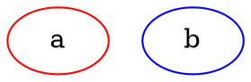

# Extending ts-graphviz

`ts-graphviz` is designed to be extensible, allowing intermediate users to customize and enhance the library's functionality to meet specific needs. This section covers how to extend the type system and create custom implementations.

## Creating Custom Classes

You can add your own implementations by inheriting from existing classes. This allows you to define custom behavior or default attributes for your graph elements.

```typescript
import { Digraph, Node, Edge, EdgeTargetTuple, attribute as _, toDot } from 'ts-graphviz';

class MyCustomDigraph extends Digraph {
  constructor() {
    super('G', {
      [_.label]: 'This is Custom Digraph',
    });
  }
}

class MyCustomNode extends Node {
  constructor(id: string) {
    super(`node_${id}`, {
      [_.label]: `This is Custom Node ${id}`,
    });
  }
}

class MyCustomEdge extends Edge {
  constructor(targets: EdgeTargetTuple) {
    super(targets, {
      [_.label]: 'This is Custom Edge',
    });
  }
}

const digraph = new MyCustomDigraph();
const node1 = new MyCustomNode('A');
const node2 = new MyCustomNode('B');
const edge = new MyCustomEdge([node1, node2]);
digraph.addNode(node1);
digraph.addNode(node2);
digraph.addEdge(edge);

const dot = toDot(digraph);
console.log(dot);
/* Output:
digraph "G" {
  label = "This is Custom Digraph";
  "node_A" [
    label = "This is Custom Node A";
  ];
  "node_B" [
    label = "This is Custom Node B";
  ];
  "node_A" -> "node_B" [
    label = "This is Custom Edge";
  ];
}
*/
```

### Models Context API (`with` method)

You can also use the **Models Context API** to create custom classes for objects generated inside a graph. The `with` methods of `Digraph`, `Graph`, and `Subgraph` allow you to predefine custom models.

```typescript
import { Digraph, Node, Edge, EdgeTargetTuple, attribute as _, toDot } from 'ts-graphviz';

class MyCustomNode extends Node {
  constructor(id: string) {
    super(`node_${id}`, {
      [_.label]: `This is Custom Node ${id}`,
    });
  }
}

class MyCustomEdge extends Edge {
  constructor(targets: EdgeTargetTuple) {
    super(targets, {
      [_.label]: 'This is Custom Edge',
    });
  }
}

const g = new Digraph();
g.with({
  Node: MyCustomNode,
  Edge: MyCustomEdge,
});

const a = g.createNode('A'); // Instance of MyCustomNode
const b = g.createNode('B'); // Instance of MyCustomNode
g.createEdge([a, b]);        // Instance of MyCustomEdge

const dot = toDot(g);
console.log(dot);
/* Output:
digraph {
  "node_A" [
    label = "This is Custom Node A";
  ];
  "node_B" [
    label = "This is Custom Node B";
  ];
  "node_A" -> "node_B" [
    label = "This is Custom Edge";
  ];
}
*/
```

### Typed custom classes

The classes of a models context also decide the types of what graphs create, in nested subgraphs too:

```typescript
import { Node, withContext } from 'ts-graphviz';

class MyNode extends Node {
  get label(): string {
    return this.id.toUpperCase();
  }
}

const { digraph } = withContext({ Node: MyNode });

digraph((g) => {
  g.node('a').label;                      // MyNode
  g.subgraph('s', (s) => s.node('b').label); // MyNode in subgraphs too
});
```

`createModelsContext`, `withContext`, `createModelFactories`, and `fromDot` / `fromDotAll` with `convert.models` infer the types from the classes given; a class left out keeps the base type, carrying the same context into subgraphs. A custom root or subgraph class that should itself return the custom types extends `RootGraph<M>` / `Subgraph<M>` with `M` describing them (`ModelTypes`).

### Ordered default attribute statements

In DOT, a default attribute statement applies only to what follows it:



The default model classes keep one set of defaults per graph (`attributes.node`, `attributes.edge`, `attributes.graph`), which `toDot` writes first, so the last values win for every node. To keep the statements where they are, use the classes of `orderedModels` (`OrderedGraph`, `OrderedDigraph`, `OrderedSubgraph`):

```typescript
import { fromDot, OrderedDigraph, orderedModels, toDot } from 'ts-graphviz';

const source = `digraph {
  node [color=red];
  a;
  node [color=blue];
  b;
}`;

const g = fromDot(source, { convert: { models: orderedModels } });

const h = new OrderedDigraph();
h.node('a');
h.addAttributeList('Node', { color: 'blue' }); // applies to what follows
h.node('b');
```

`addAttributeList(kind, attributes)` exists on every graph model: the default classes merge it into `attributes`, the ordered classes put it into `statements` once something precedes it. Graphs keep nodes, edges and subgraphs in the order they were added either way.

## Extending the Type System

With `ts-graphviz`, you can extend the library's type system to customize graph visualization solutions. This is useful when you need to specify custom graph layouts, output formats, or add custom attributes not supported by default.

### Customization with the `$` Symbol

To allow for customization, types intended for extension are named with the `$` symbol. If you need to extend a type definition not listed below, check the source code to see if it can be extended with `$...`. If not, please create an issue or pull request.

### Use Cases

#### Specifying Custom Graph Layout and Output Formats

Layout engines and output formats that a Graphviz plugin adds are named per call with the `customLayouts` and `customFormats` options. They are trusted configuration, like `dotCommand`: define them in your code, never from end-user input. A `format` or `layout` from a request is checked against the documented names only (`isFormat` / `isLayout`).

```typescript
import { toBlob } from '@ts-graphviz/adapter';

// List the names your Graphviz plugins add for this call: they are accepted
// at run time and widen the types of `format` and `layout` for this call
// only. Nothing is changed globally, and `isFormat` / `isLayout` still
// answer for the documented names only.
const video = await toBlob('digraph { a -> b }', {
  customLayouts: ['my-custom-algorithm'],
  customFormats: ['mp4'],
  layout: 'my-custom-algorithm',
  format: 'mp4',
  // sanitize refuses formats it has not checked
  sanitize: false,
});
```

#### Adding Custom Attributes

You can add custom attributes by extending the types in `@ts-graphviz/common`:

```typescript
import { $keywords } from '@ts-graphviz/common';
import { digraph, toDot, attribute as _ } from 'ts-graphviz';

// 1. Declare the '@ts-graphviz/common' module.
declare module '@ts-graphviz/common' {
  export namespace GraphAttributeKey {
    // 2. Define the $values interface in the GraphAttributeKey namespace.
    // 3. Extend $keywords with the name of your custom attribute.
    export interface $values extends $keywords<'hoge'> {}
  }

  export namespace Attribute {
    // 4. Define the $keys interface in the Attribute namespace.
    // 5. Extend $keywords with the name of your custom attribute.
    export interface $keys extends $keywords<'hoge'> {}

    // 6. Define the $types interface in the Attribute namespace.
    // 7. Specify the type of your custom attribute.
    export interface $types {
      hoge: string;
    }
  }
}

// Now you can use your custom attribute.
console.log(
  toDot(
    digraph((g) => {
      g.set(_.hoge, 'fuga');
    }),
  ),
);
```

### Extensions and security

Type extensions change TypeScript types only; nothing is added at run time. They are the application's responsibility, and two things follow when the DOT comes from an untrusted party (see the [Security model](../11-advanced-topics/06-security-model.md), SM-5 and SM-7):

- `sanitize`, which the adapter runs by default, does not know your extensions. A custom output format is refused while it is on; pass `sanitize: false` only if the DOT is your own. With `policy: 'strict'`, custom attributes are rejected as unknown.
- A custom attribute is passed to Graphviz like any other. Before rendering untrusted values in it, make sure the Graphviz plugin that reads it does not read files or write its value unescaped.

---


## Internal Package Overview

For users interested in extending or customizing `ts-graphviz`, understanding the internal packages can be valuable. Below is an overview of the internal packages and how they can be used in advanced scenarios.


### `@ts-graphviz/adapter`

**Purpose**: Provides interfaces to execute Graphviz commands and convert DOT language strings into various output formats.

**Usage**:

- Convert DOT strings to streams or files.
- Use in environments where you need to render graphs to images or other formats.

:::note
You can use either `@ts-graphviz/adapter` or `ts-graphviz/adapter` imports. The latter is maintained for backward compatibility.
:::


### `@ts-graphviz/ast`

**Purpose**: Allows manipulation of the DOT language at the Abstract Syntax Tree (AST) level.

**Usage**:

- Parse DOT strings into AST nodes.
- Manipulate and transform the AST programmatically.
- Useful for advanced analysis or transformations of existing DOT code.

:::note
You can use either `@ts-graphviz/ast` or `ts-graphviz/ast` imports. The latter is maintained for backward compatibility.
:::

### `@ts-graphviz/common`

**Purpose**: Centralizes Graphviz domain knowledge, providing type definitions, constants, and utilities. It is designed to handle use cases such as extending types.

**Usage**:

- Extend or customize types and attributes.
- Ensure type safety when working with custom attributes.
- Aggregate domain knowledge of Graphviz for consistent usage across packages.

### `@ts-graphviz/core`

**Purpose**: Contains the core implementations of the models and functions provided to users.

**Usage**:

- Use object-oriented APIs for fine-grained control over graph elements.
- Extend classes for custom behaviors or attributes.
