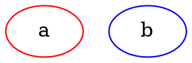

# Extending ts-graphviz

`ts-graphviz` is designed to be extensible, allowing intermediate users to customize and enhance the library's functionality to meet specific needs. This section covers how to extend the type system and create custom implementations. For the models themselves, see [DOT Object Model (DOM)](./02-model-api.md).

## Creating Custom Classes

You can add your own implementations by inheriting from existing classes. This allows you to define custom behavior or default attributes for your graph elements.

```typescript
import { Digraph, Node, Edge, EdgeTargetTuple, attribute as _, toDot } from 'ts-graphviz';

class MyCustomDigraph extends Digraph {
  constructor() {
    super('G', {
      [_.label]: 'This is Custom Digraph',
    });
  }
}

class MyCustomNode extends Node {
  constructor(id: string) {
    super(`node_${id}`, {
      [_.label]: `This is Custom Node ${id}`,
    });
  }
}

class MyCustomEdge extends Edge {
  constructor(targets: EdgeTargetTuple) {
    super(targets, {
      [_.label]: 'This is Custom Edge',
    });
  }
}

const digraph = new MyCustomDigraph();
const node1 = new MyCustomNode('A');
const node2 = new MyCustomNode('B');
const edge = new MyCustomEdge([node1, node2]);
digraph.addNode(node1);
digraph.addNode(node2);
digraph.addEdge(edge);

const dot = toDot(digraph);
console.log(dot);
/* Output:
digraph "G" {
  label = "This is Custom Digraph";
  "node_A" [
    label = "This is Custom Node A";
  ];
  "node_B" [
    label = "This is Custom Node B";
  ];
  "node_A" -> "node_B" [
    label = "This is Custom Edge";
  ];
}
*/
```

### A kit of custom classes (`createModelKit`)

A model kit creates models from the classes you give it. `createModelKit` takes the custom classes and uses the default ones for the rest.

```typescript
import {
  createModelKit,
  Node,
  Edge,
  type EdgeAttributesObject,
  type EdgeTargetTuple,
  type NodeAttributesObject,
  attribute as _,
  toDot,
} from 'ts-graphviz';

class MyCustomNode extends Node {
  constructor(id: string, attributes?: NodeAttributesObject) {
    super(`node_${id}`, {
      [_.label]: `This is Custom Node ${id}`,
      ...attributes,
    });
  }
}

class MyCustomEdge extends Edge {
  constructor(targets: EdgeTargetTuple, attributes?: EdgeAttributesObject) {
    super(targets, {
      [_.label]: 'This is Custom Edge',
      ...attributes,
    });
  }
}

const kit = createModelKit({
  Node: MyCustomNode,
  Edge: MyCustomEdge,
});

const g = kit.createDigraph();
const a = kit.createNode('A'); // Instance of MyCustomNode
const b = kit.createNode('B'); // Instance of MyCustomNode
g.addNode(a);
g.addNode(b);
g.addEdge(kit.createEdge([a, b])); // Instance of MyCustomEdge

const dot = toDot(g);
console.log(dot);
/* Output:
digraph {
  "node_A" [
    label = "This is Custom Node A";
  ];
  "node_B" [
    label = "This is Custom Node B";
  ];
  "node_A" -> "node_B" [
    label = "This is Custom Edge";
  ];
}
*/
```

### Typed custom classes

The classes of a model kit also decide the types of what the kit and the DOT DSL create, in nested subgraphs too:

```typescript
import { modelOf, Node, withModelKit } from 'ts-graphviz';

class MyNode extends Node {
  get shout(): string {
    return this.id.toUpperCase();
  }
}

const { digraph } = withModelKit({ Node: MyNode });

digraph((g) => {
  modelOf(g.node('a')).shout; // 'A' (the model is typed MyNode)
  g.subgraph('s', (s) => {
    modelOf(s.node('b')).shout; // 'B' (MyNode in subgraphs too)
  });
});
```

`createModelKit`, `withModelKit`, `createModelFactories`, and `fromDot` / `fromDotAll` with `convert.models` infer the types from the classes given; a class left out keeps the base type, and subgraphs get the same classes. What a graph holds (`getNodes`, `getEdges`, …) has the model interfaces (`NodeModel` and so on): check with `instanceof` to reach the members of your class.

### Default attribute statements in place

In DOT, a default attribute statement applies only to what follows it:



The model classes keep each default attribute statement where it was written, so a graph read with `fromDot`, or built by hand, renders as DOT says. `addAttributeList(kind, attributes)` adds one and returns its list, which you can keep to change those defaults later (the DSL's `g.node({ ... })` returns its DSL):

```typescript
import { Digraph, fromDot, Node, toDot } from 'ts-graphviz';

const source = `digraph {
  node [color=red];
  a;
  node [color=blue];
  b;
}`;

const g = fromDot(source); // a red, b blue

const h = new Digraph();
h.addNode(new Node('a'));
const defaults = h.addAttributeList('Node', { color: 'blue' }); // applies to what follows
h.addNode(new Node('b'));
defaults.setAttribute('color', 'green');
console.log(toDot(h));
```

The classes of 3.x kept one set of defaults per graph (`attributes.node`, `attributes.edge`, `attributes.graph`), written first, so the last values won for every node. They are kept, deprecated until v5, as `legacyModels` (`LegacyGraph`, `LegacyDigraph`, `LegacySubgraph`), and `ts-graphviz/legacy` is the same API with them: `fromDot(source, { convert: { models: legacyModels } })`, `createModelKit(legacyModels)` to build by hand, or `import { digraph } from 'ts-graphviz/legacy'`. `attributes` is deprecated too: write a default attribute statement instead.

## Extending the Type System

With `ts-graphviz`, you can extend the library's type system to customize graph visualization solutions. This is useful when you need to specify custom graph layouts, output formats, or add custom attributes not supported by default.

### Types of your own

Attributes and value types of your own, and the layout engines and output formats a Graphviz plugin adds, are named in a schema (`defineSchema`): its attributes type the models of one kit, and its formats and layouts the calls of the adapter given it. Nothing is changed for the whole program: the types are not extended with declaration merging (`declare module '@ts-graphviz/common'`).

### Use Cases

#### Specifying Custom Graph Layout and Output Formats

Layout engines and output formats that a Graphviz plugin adds are named in a schema's `types.layout` and `types.format`, with the names (`values.extend('mp4')`), and the schema is given to the adapter's `schema` option. A schema is trusted configuration, like `dotCommand`: define it in your code, never from end-user input. A `format` or `layout` from a request is checked against the documented names only (`isFormat` / `isLayout`).

```typescript
import { toBlob } from '@ts-graphviz/adapter';
import { defineSchema, values } from '@ts-graphviz/common';

// Name the layout engines and output formats your Graphviz plugins add in a
// schema: given as `schema`, they are accepted at run time and widen the
// types of `layout` and `format` for that call only. Nothing is changed
// globally, and `isFormat` / `isLayout` still answer for the documented
// names only.
const schema = defineSchema({
  types: {
    layout: values.extend('my-custom-algorithm'),
    format: values.extend('mp4'),
  },
});
const video = await toBlob('digraph { a -> b }', {
  schema,
  layout: 'my-custom-algorithm',
  format: 'mp4',
  // sanitize refuses formats it has not checked
  sanitize: false,
});
```

#### Adding Custom Attributes

A schema lists the attributes and value types the models of a kit take beyond (or instead of) the built-in ones:

```typescript
import { attr, defineSchema, toDot, values, withModelKit } from 'ts-graphviz';

// The attributes and value types your graphs take beyond the built-in ones.
const schema = defineSchema({
  graph: { hoge: attr<string>() }, // a new attribute
  node: {
    'data-id': attr<number>(),
    label: attr.override<number>(), // a number instead of the built-in type
  },
  types: { color: values.extend<'brand-blue'>() }, // every color attribute
});

const { digraph } = withModelKit({ schema });
console.log(
  toDot(
    digraph((g) => {
      g.hoge = 'fuga';
      g.node('a', { 'data-id': 1, label: 2, color: 'brand-blue' });
    }),
  ),
);
```

- `attr<T>()` adds an attribute; `attr.extend<T>()` (the built-in type, or `T`) and `attr.override<T>()` (`T` instead) change a built-in one. Each entry gives its type, and which of them applies is always said: `attr<T>()` on a built-in attribute is a type error.
- `types` changes a value type (`color`, `style`, `shape`, `arrowType`, …) and so every attribute that uses it, with `values.extend<T>()` or `values.override<T>()`.
- The kinds are `graph`, `subgraph`, `cluster`, `node` and `edge`.
- Only the models of that kit are typed with the schema: `withModelKit({ schema })`, `createModelKit({ schema, Node: MyNode })` (with `class MyNode extends Node<typeof schema> {}`) and `fromDot(dot, { convert: { models: { schema } } })`. Other graphs, a library's for instance, are not changed.

### Extensions and security

Type extensions change TypeScript types only; nothing is added at run time. They are the application's responsibility, and two things follow when the DOT comes from an untrusted party (see the [Security model](../11-advanced-topics/06-security-model.md), SM-5 and SM-7):

- `sanitize`, which the adapter runs by default, does not know your extensions. A custom output format is refused while it is on; pass `sanitize: false` only if the DOT is your own. With `policy: 'strict'`, custom attributes are rejected as unknown.
- A custom attribute is passed to Graphviz like any other. Before rendering untrusted values in it, make sure the Graphviz plugin that reads it does not read files or write its value unescaped.

---


## Internal Package Overview

For users interested in extending or customizing `ts-graphviz`, understanding the internal packages can be valuable. Below is an overview of the internal packages and how they can be used in advanced scenarios.


### `@ts-graphviz/adapter`

**Purpose**: Provides interfaces to execute Graphviz commands and convert DOT language strings into various output formats.

**Usage**:

- Render DOT strings to a `Blob` with `toBlob`.
- Use in environments where you need to render graphs to images or other formats.

:::note
You can use either `@ts-graphviz/adapter` or `ts-graphviz/adapter` imports. The latter is maintained for backward compatibility.
:::


### `@ts-graphviz/ast`

**Purpose**: Allows manipulation of the DOT language at the Abstract Syntax Tree (AST) level.

**Usage**:

- Parse DOT strings into AST nodes.
- Manipulate and transform the AST programmatically.
- Useful for advanced analysis or transformations of existing DOT code.

:::note
You can use either `@ts-graphviz/ast` or `ts-graphviz/ast` imports. The latter is maintained for backward compatibility.
:::

### `@ts-graphviz/common`

**Purpose**: Centralizes Graphviz domain knowledge, providing type definitions, constants, and utilities. It is designed to handle use cases such as extending types.

**Usage**:

- Extend or customize types and attributes.
- Ensure type safety when working with custom attributes.
- Aggregate domain knowledge of Graphviz for consistent usage across packages.

### `@ts-graphviz/core`

**Purpose**: Contains the core implementations of the models and functions provided to users.

**Usage**:

- Use object-oriented APIs for fine-grained control over graph elements.
- Extend classes for custom behaviors or attributes.
