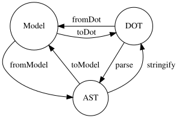

# Using Abstract Syntax Tree (AST)

For advanced use cases, `ts-graphviz/ast` module provides an API to handle Abstract Syntax Trees (ASTs) of DOT language graphs.

## Available Functions

The following functions are provided:

- `fromModel`: Converts a **Model** to an **AST**.
- `toModel`: Converts an **AST** to a **Model**.
- `stringify`: Converts an **AST** to a **DOT** string.
- `parse`: Converts a **DOT** string to an **AST**.



:::note
The `toDot` function provided by the `ts-graphviz` package is a composition of `fromModel` and `stringify`. The `fromDot` function is a composition of `parse` and `toModel`.
:::

The module also provides `sanitize`, which checks a DOT string before it is rendered (see [Checking untrusted DOT](#checking-untrusted-dot)).

## Example

### Parsing a DOT String into an AST


```typescript
import { parse } from 'ts-graphviz/ast';

const ast = parse(`
  digraph example {
    node1 [
      label = "My Node",
    ]
  }
`);

console.log(JSON.stringify(ast, null, 2));
```

The `ast` variable now contains the AST representation of the DOT graph, which you can manipulate programmatically.

<details>
<summary>Click to view the AST structure</summary>

```json
{
  "location": {
    "start": {
      "offset": 3,
      "line": 2,
      "column": 3
    },
    "end": {
      "offset": 68,
      "line": 7,
      "column": 1
    }
  },
  "type": "Dot",
  "children": [
    {
      "location": {
        "start": {
          "offset": 3,
          "line": 2,
          "column": 3
        },
        "end": {
          "offset": 67,
          "line": 6,
          "column": 4
        }
      },
      "id": {
        "location": {
          "start": {
            "offset": 11,
            "line": 2,
            "column": 11
          },
          "end": {
            "offset": 18,
            "line": 2,
            "column": 18
          }
        },
        "value": "example",
        "kind": "bare",
        "type": "Literal"
      },
      "directed": true,
      "strict": false,
      "type": "Graph",
      "children": [
        {
          "location": {
            "start": {
              "offset": 25,
              "line": 3,
              "column": 5
            },
            "end": {
              "offset": 63,
              "line": 5,
              "column": 6
            }
          },
          "id": {
            "location": {
              "start": {
                "offset": 25,
                "line": 3,
                "column": 5
              },
              "end": {
                "offset": 30,
                "line": 3,
                "column": 10
              }
            },
            "value": "node1",
            "kind": "bare",
            "type": "Literal"
          },
          "type": "Node",
          "children": [
            {
              "location": {
                "start": {
                  "offset": 39,
                  "line": 4,
                  "column": 7
                },
                "end": {
                  "offset": 57,
                  "line": 4,
                  "column": 25
                }
              },
              "key": {
                "location": {
                  "start": {
                    "offset": 39,
                    "line": 4,
                    "column": 7
                  },
                  "end": {
                    "offset": 44,
                    "line": 4,
                    "column": 12
                  }
                },
                "value": "label",
                "kind": "bare",
                "type": "Literal"
              },
              "value": {
                "location": {
                  "start": {
                    "offset": 47,
                    "line": 4,
                    "column": 15
                  },
                  "end": {
                    "offset": 56,
                    "line": 4,
                    "column": 24
                  }
                },
                "value": "My Node",
                "kind": "quoted",
                "type": "Literal"
              },
              "type": "Attribute"
            }
          ]
        }
      ]
    }
  ]
}
```

</details>

Each node has a `type`. A node read by the parser has a `location` in the source; a node made by `fromModel` or `createElement` has none. `Dot`, `Graph`, `Subgraph`, `Node`, `Edge` and `AttributeList` nodes keep their statements in `children`. `Literal`, `Attribute`, `Comment` and `NodeRef` nodes are leaves and have no `children`.

A `Literal` has a `kind` that says how its `value` is written:

| `kind` | In DOT | `value` |
| --- | --- | --- |
| `'bare'` | `node1` | the identifier or number |
| `'quoted'` | `"My Node"` | the text between the quotes, as written in the source, escape sequences included |
| `'html'` | `<<b>My Node</b>>` | the markup between the outer `<` and `>` |

### Parsing a Part of a Graph

By default `parse` reads a whole DOT source and returns a `Dot` node. The `as` option names another rule to read, and the result is typed by it: `'Graph'`, `'Subgraph'`, `'Node'`, `'Edge'`, `'AttributeList'`, `'Attribute'` or `'ClusterStatements'`.

```typescript
import { parse } from 'ts-graphviz/ast';

const edge = parse('a -> b [color = red];', { as: 'Edge' });

console.log(edge.type); // 'Edge'
console.log(edge.targets.map((target) => target.type)); // ['NodeRef', 'NodeRef']
console.log(edge.children.map((child) => child.type)); // ['Attribute']
```

A source that does not parse throws a `DotSyntaxError`, whose `code` is `TSG_ERR_DOT_SYNTAX` and whose `location` is the place of the error. `parse` also takes limits for untrusted input, such as `maxInputSize` and `maxASTNodes`; a source over a limit throws a `DotSyntaxError` whose `limit` names the option.

### Editing an AST and Writing DOT

`stringify` writes an AST as DOT. A literal is written as its `kind` says, so the output keeps the quoting of the source.

```typescript
import { parse, stringify } from 'ts-graphviz/ast';

const ast = parse('digraph { a [label = "A"]; a -> b; }');

for (const graph of ast.children) {
  if (graph.type !== 'Graph') continue;
  for (const statement of graph.children) {
    if (statement.type === 'Node') {
      statement.id.value = `n_${statement.id.value}`;
    }
  }
}

console.log(stringify(ast));
// digraph {
//   n_a [
//     label = "A";
//   ];
//   a -> b;
// }
```

`stringify` takes the print options `indentStyle` (`'space'` or `'tab'`), `indentSize` and `endOfLine` (`'lf'` or `'crlf'`).

### Converting between an AST and a Model

`toModel` creates models from an AST. It needs the classes to create them from, in the `models` option: `defaultModelsContext()` gives the classes of ts-graphviz, and `createModelsContext({ ... })` a context with your own classes.

A `Dot` node becomes a `Dot` model, which holds every graph of the source in `graphs`:

```typescript
import { defaultModelsContext } from 'ts-graphviz';
import { parse, toModel } from 'ts-graphviz/ast';

const ast = parse('digraph G { a -> b; } graph H { c; }');
const dot = toModel(ast, { models: defaultModelsContext() });

console.log(dot.$$type); // 'Dot'
console.log(dot.graphs.map((g) => g.id)); // ['G', 'H']
console.log(dot.graphs.map((g) => g.directed)); // [true, false]
```

`fromModel` goes the other way. It takes any model, or its [DOT DSL](./01-dot-dsl.md), and returns the AST node of that kind:

```typescript
import { digraph, modelOf } from 'ts-graphviz';
import { fromModel, stringify } from 'ts-graphviz/ast';

const G = digraph('G', (g) => {
  g.node('a', { label: 'A' });
  g.edge(['a', 'b']);
});

const ast = fromModel(G);
console.log(ast.type); // 'Graph'
console.log(ast.children.map((child) => child.type)); // ['Node', 'Edge']

const [a] = modelOf(G).nodes;
console.log(stringify(fromModel(a)));
// "a" [
//   label = "A";
// ];
```

A string in a model is literal text, and a quoted `Literal` holds DOT source text. The escaping and unescaping happen in `fromModel` and `toModel`, so do not copy one into the other by hand.

## Checking untrusted DOT {#checking-untrusted-dot}

Graphviz reads the files a DOT source names (`image`, `shapefile`, …) and writes the links it gives into its output. `sanitize(dot, options?)` parses the source, rejects such constructs with a `DOMException` named `SecurityError` (`code` `TSG_ERR_UNSAFE_DOT`), and returns the checked text, printed again from the AST. The adapter's `toBlob` runs it by default (see [Rendering Graphs to Images](./03-rendering-graphs-to-images.md#sanitizing-the-dot-source)). It is a check, not a sandbox: the [Security model](../11-advanced-topics/06-security-model.md) says what it covers.

```typescript
import { sanitize } from 'ts-graphviz/ast';

console.log(sanitize('digraph { a [URL = "https://example.com/"]; }'));
// digraph {
//   a [
//     URL = "https://example.com/";
//   ];
// }

try {
  sanitize('digraph { a [image = "/etc/passwd"]; }');
} catch (e) {
  console.log(e instanceof DOMException && e.name); // 'SecurityError'
}
```

## Upgrading

If your code reads `quoted` on literals or `children` on leaf nodes, passes `startRule` to `parse`, or calls `toModel` without `models`, see the [migration guide](../99-migration-guides/v3-to-v4/index.md).
